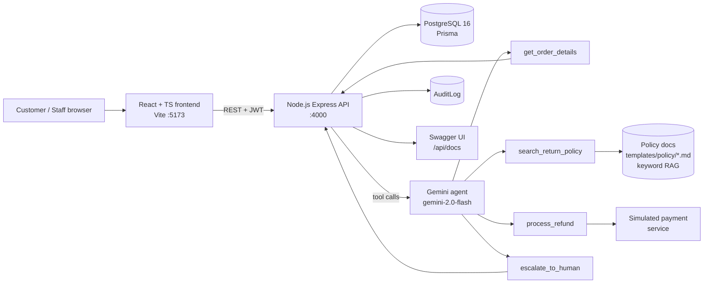

# 02 — Architecture

## 1. System diagram



Full Mermaid source: `docs/architecture.mmd`. Render at mermaid.live.

## 2. Request flows

### 2.1 Authenticated API call
```
Browser → Axios (Authorization: Bearer <jwt>) → Express auth middleware
  → verify JWT → attach req.user → role guard (if staff-only)
  → Zod validate body/query → service layer (business rules)
  → Prisma → JSON response (consistent envelope)
```

### 2.2 AI chat with tools (Gemini function calling)
```
POST /api/chat { ticketId?, message }
  → auth + load ticket (ownership check) + load last 20 messages
  → build Gemini history (system prompt + context + user message)
  → Gemini generates text OR function call
  → if function call: execute tool (backend service, re-validated)
  → append tool result → Gemini generates final text
  → persist customer + agent messages → return { reply, ticketId, actions[] }
```
Mock mode replaces the Gemini step with deterministic rules (same tool functions, same persistence).

### 2.3 Refund execution (separation of decision vs execution)
```
process_refund tool / POST /api/refunds
  → RefundService.validateEligibility()  [ownership, window, amount, duplicate]
  → if amount > 5000 → create ESCALATED refund + Escalation, return pending
  → else create APPROVED refund → SimulatedPaymentService.execute()
  → PROCESSED (or FAILED) → audit + ticket message
Staff approve on ESCALATED → same execute path. LLM never writes PROCESSED directly.
```

## 3. Folder structure (agent must create exactly this)

```
ecommerce-support-platform/
├── docker-compose.yml
├── README.md
├── .env.example
├── backend/
│   ├── package.json
│   ├── tsconfig.json
│   ├── Dockerfile
│   ├── prisma/
│   │   ├── schema.prisma
│   │   ├── seed.ts
│   │   └── migrations/
│   ├── src/
│   │   ├── index.ts              # app bootstrap (listen, health)
│   │   ├── app.ts                # express app, middleware, routes
│   │   ├── config/env.ts         # env parsing + validation
│   │   ├── lib/prisma.ts         # PrismaClient singleton
│   │   ├── lib/logger.ts         # pino setup
│   │   ├── lib/errors.ts         # ApiError + error envelope
│   │   ├── middleware/auth.ts    # JWT verify + requireRole
│   │   ├── middleware/validate.ts# Zod validation helper
│   │   ├── middleware/errorHandler.ts
│   │   ├── routes/auth.routes.ts
│   │   ├── routes/orders.routes.ts
│   │   ├── routes/tickets.routes.ts
│   │   ├── routes/refunds.routes.ts
│   │   ├── routes/escalations.routes.ts
│   │   ├── routes/chat.routes.ts
│   │   ├── routes/users.routes.ts
│   │   ├── services/auth.service.ts
│   │   ├── services/order.service.ts
│   │   ├── services/ticket.service.ts
│   │   ├── services/refund.service.ts      # eligibility + execution (sole authority)
│   │   ├── services/escalation.service.ts
│   │   ├── services/audit.service.ts
│   │   ├── services/payment.simulated.ts   # mock payment gateway
│   │   ├── ai/agent.ts                     # Gemini orchestration
│   │   ├── ai/tools.ts                     # 4 tool definitions + executors
│   │   ├── ai/policy.ts                    # keyword RAG over policy docs
│   │   ├── ai/mockAgent.ts                 # deterministic fallback
│   │   ├── ai/systemPrompt.ts              # hardened system prompt
│   │   └── utils/pagination.ts
│   ├── policy/                             # copy of templates/policy/*.md
│   └── tests/
│       ├── setup.ts
│       ├── auth.test.ts
│       ├── tickets.test.ts
│       ├── refunds.test.ts
│       ├── agent.test.ts
│       └── security.test.ts
└── frontend/
    ├── package.json
    ├── tsconfig.json
    ├── vite.config.ts
    ├── Dockerfile
    ├── index.html
    └── src/
        ├── main.tsx
        ├── App.tsx                 # router + providers
        ├── styles/tokens.css       # Industrial tokens (see 12-DESIGN-SYSTEM.md)
        ├── styles/global.css
        ├── lib/api.ts              # axios instance + interceptors
        ├── lib/types.ts            # shared API types
        ├── context/AuthContext.tsx
        ├── hooks/useAuth.ts
        ├── components/Layout.tsx
        ├── components/StatusBadge.tsx
        ├── components/EmptyState.tsx
        ├── components/LoadingState.tsx
        ├── components/ErrorState.tsx
        ├── pages/Login.tsx
        ├── pages/Register.tsx
        ├── pages/customer/Dashboard.tsx
        ├── pages/customer/Orders.tsx
        ├── pages/customer/OrderDetail.tsx
        ├── pages/customer/NewTicket.tsx
        ├── pages/customer/Tickets.tsx
        ├── pages/customer/TicketDetail.tsx   # chat thread + refund progress
        ├── pages/customer/Refunds.tsx
        ├── pages/staff/StaffDashboard.tsx
        ├── pages/staff/StaffTickets.tsx
        ├── pages/staff/StaffTicketDetail.tsx
        ├── pages/staff/Escalations.tsx
        └── pages/staff/StaffRefunds.tsx
```

## 4. Key decisions

- **Express over Fastify:** larger ecosystem, simpler middleware mental model; Zod compensates for schema validation.
- **Prisma over raw pg:** typed queries, migrations, seed — satisfies "migrations or repeatable init" with less code.
- **Keyword RAG over vector DB:** policy corpus is ~5 docs; TF-IDF/keyword scoring is inspectable, zero infra, and explicitly allowed ("vector **or** keyword retrieval").
- **Single JWT (24h) over refresh rotation:** simpler for evaluation; logout = client discard + audit. Documented trade-off.
- **Simulated payment as a service class:** swappable for a real gateway later without touching refund logic.
