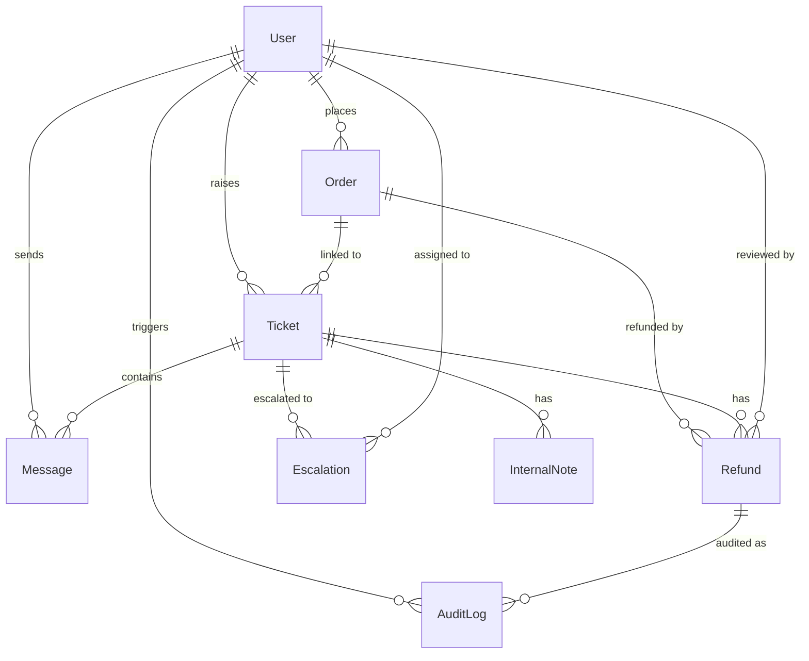

# 03 — Database Schema (PostgreSQL via Prisma)

## 1. ERD



Source: `docs/erd.mmd`.

## 2. Enums

```prisma
enum Role        { CUSTOMER SUPPORT ADMIN }
enum OrderStatus { PLACED SHIPPED DELIVERED CANCELLED RETURNED }
enum TicketStatus{ OPEN IN_PROGRESS ESCALATED RESOLVED CLOSED }
enum Priority    { LOW MEDIUM HIGH URGENT }
enum TicketCategory { ORDER_ISSUE RETURN_REFUND PAYMENT PRODUCT_QUESTION OTHER }
enum SenderType  { CUSTOMER AGENT AI STAFF SYSTEM }
enum RefundStatus{ PENDING_REVIEW APPROVED REJECTED ESCALATED PROCESSED FAILED }
enum EscalationDecision { PENDING APPROVED REJECTED NEEDS_INFO }
```

## 3. Models (Prisma — agent must create `prisma/schema.prisma` with these)

```prisma
model User {
  id           String   @id @default(uuid())
  name         String
  email        String   @unique
  passwordHash String
  role         Role     @default(CUSTOMER)
  createdAt    DateTime @default(now())
  updatedAt    DateTime @updatedAt
  orders       Order[]
  tickets      Ticket[]  @relation("TicketCustomer")
  messages     Message[]
  assignedTickets Ticket[] @relation("TicketAssignee")
  reviewedRefunds Refund[] @relation("RefundReviewer")
  assignedEscalations Escalation[] @relation("EscalationAssignee")
  auditLogs    AuditLog[]
  @@index([role])
}

model Order {
  id           String      @id @default(uuid())
  customerId   String
  customer     User        @relation(fields: [customerId], references: [id], onDelete: Cascade)
  status       OrderStatus @default(PLACED)
  deliveryDate DateTime?
  totalAmount  Decimal     @db.Decimal(10, 2)
  items        Json        // [{ name, category, qty, unitPrice }]
  createdAt    DateTime    @default(now())
  updatedAt    DateTime    @updatedAt
  tickets      Ticket[]
  refunds      Refund[]
  @@index([customerId])
  @@index([status])
}

model Ticket {
  id          String         @id @default(uuid())
  customerId  String
  customer    User           @relation("TicketCustomer", fields: [customerId], references: [id], onDelete: Cascade)
  orderId     String?
  order       Order?         @relation(fields: [orderId], references: [id], onDelete: SetNull)
  subject     String
  description String
  category    TicketCategory
  status      TicketStatus   @default(OPEN)
  priority    Priority       @default(MEDIUM)
  assigneeId  String?
  assignee    User?          @relation("TicketAssignee", fields: [assigneeId], references: [id], onDelete: SetNull)
  createdAt   DateTime       @default(now())
  updatedAt   DateTime       @updatedAt
  messages    Message[]
  refunds     Refund[]
  escalations Escalation[]
  notes       InternalNote[]
  @@index([customerId])
  @@index([status])
  @@index([priority])
  @@index([createdAt])
}

model Message {
  id         String     @id @default(uuid())
  ticketId   String
  ticket     Ticket     @relation(fields: [ticketId], references: [id], onDelete: Cascade)
  senderId   String?
  sender     User?      @relation(fields: [senderId], references: [id], onDelete: SetNull)
  senderType SenderType
  content    String
  createdAt  DateTime   @default(now())
  @@index([ticketId, createdAt])
}

model Refund {
  id             String       @id @default(uuid())
  orderId        String
  order          Order        @relation(fields: [orderId], references: [id], onDelete: Cascade)
  ticketId       String?
  ticket         Ticket?      @relation(fields: [ticketId], references: [id], onDelete: SetNull)
  amount         Decimal      @db.Decimal(10, 2)
  reason         String
  status         RefundStatus @default(PENDING_REVIEW)
  requestedBy    String       // user id (customer or staff on behalf)
  reviewedBy     String?
  reviewer       User?        @relation("RefundReviewer", fields: [reviewedBy], references: [id], onDelete: SetNull)
  idempotencyKey String       @unique
  paymentRef     String?      // simulated gateway reference
  createdAt      DateTime     @default(now())
  updatedAt      DateTime     @updatedAt
  @@index([orderId])
  @@index([status])
}

model Escalation {
  id           String             @id @default(uuid())
  ticketId     String
  ticket       Ticket             @relation(fields: [ticketId], references: [id], onDelete: Cascade)
  summary      String
  priority     Priority           @default(HIGH)
  assignedToId String?
  assignedTo   User?              @relation("EscalationAssignee", fields: [assignedToId], references: [id], onDelete: SetNull)
  decision     EscalationDecision @default(PENDING)
  internalNote String?
  createdAt    DateTime           @default(now())
  updatedAt    DateTime           @updatedAt
  @@index([ticketId])
  @@index([decision])
}

model InternalNote {
  id        String   @id @default(uuid())
  ticketId  String
  ticket    Ticket   @relation(fields: [ticketId], references: [id], onDelete: Cascade)
  authorId  String
  content   String
  createdAt DateTime @default(now())
  @@index([ticketId])
}

model AuditLog {
  id        String   @id @default(uuid())
  userId    String?
  user      User?    @relation(fields: [userId], references: [id], onDelete: SetNull)
  action    String   // e.g. REFUND_APPROVED, ESCALATION_CREATED
  entity    String   // e.g. Refund, Ticket
  entityId  String
  details   Json?
  createdAt DateTime @default(now())
  @@index([entity, entityId])
  @@index([createdAt])
}
```

**Rules:** All FKs with `onDelete` as above. `Refund.idempotencyKey` UNIQUE is the duplicate-transaction guard. `Order.items` is JSON (acceptable for mock commerce; document it). Money always `Decimal(10,2)`, never float.

## 4. Migrations

- `npx prisma migrate dev --name init` on first run; commit the migration folder.
- Docker entrypoint runs `prisma migrate deploy` before starting the server (see `11-DEVOPS-DOCKER.md`).
- No raw SQL anywhere except Prisma-generated migrations.

## 5. Seed data (agent must implement `prisma/seed.ts`)

| User | Email | Password | Role |
|---|---|---|---|
| Admin User | `admin@shop.local` | `Admin@123` | ADMIN |
| Support Agent | `support@shop.local` | `Support@123` | SUPPORT |
| Priya Sharma | `priya@example.com` | `Customer@123` | CUSTOMER |
| Rahul Verma | `rahul@example.com` | `Customer@123` | CUSTOMER |

Orders (relative to `now()` so windows are deterministic):
- `ORD-1001` (Priya, DELIVERED 2 days ago, ₹2,499, Electronics) — **eligible refund**.
- `ORD-1002` (Priya, DELIVERED 30 days ago, ₹1,899, Clothing) — **expired window**.
- `ORD-1003` (Rahul, DELIVERED 3 days ago, ₹8,500, Electronics) — **> ₹5,000 escalation**.
- `ORD-1004` (Rahul, SHIPPED, ₹999, Books) — not delivered (refund must fail).
- 2–3 tickets in mixed statuses + 1 pending escalation for the staff queue.

Full JSON: `templates/seed/seed-data.json`. Passwords are hashed at seed time with bcrypt (never stored plain).

## 6. Indexes rationale

`Ticket(status, priority, createdAt)` for staff queue filtering; `Message(ticketId, createdAt)` for thread ordering; `Refund(orderId, status)` for duplicate checks; `AuditLog(entity, entityId)` for traceability.
